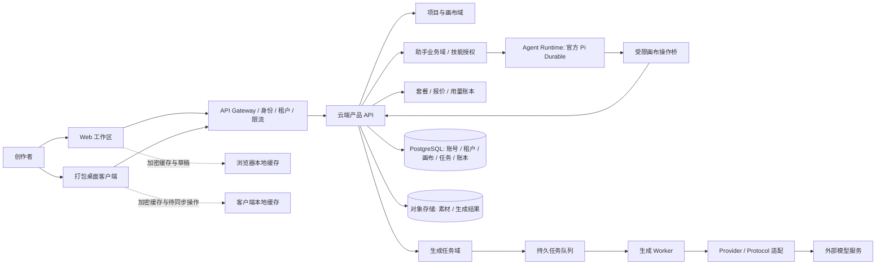

# 波波 AI 画布产品需求文档

| 项目 | 内容 |
| --- | --- |
| 产品名称 | 波波 AI 画布 |
| 产品形态 | Web + 可打包客户端，连接远端商业化服务 |
| 文档版本 | 1.5 |
| 基线日期 | 2026-10-22 |
| 当前阶段 | Web MVP 验证与远端商业化打包方案设计 |

## 1. 产品概述

波波 AI 画布是一款由场景智能体驱动的视觉内容创作服务，画布是承接创作过程与交付结果的工作空间。用户可以从“做一套商品宣传图”“制作社媒图文”“把图片发展成短视频”等目标开始，也可以直接用自然语言描述需求。智能体通过对话补齐信息、选择工作流和技能、编排图像或视频生成，并把提示词、参考素材、任务状态及结果组织到画布中，方便用户检查、修改和继续创作。

产品对标 JustAI 小加同学这类围绕用户目标提供服务的对话式 Agent 产品：用户表达要完成的事情，Agent 理解场景、引导补充信息、调用适合的能力并组织产出。波波聚焦视觉创作及营销内容，不照搬本地生活营销码、评价引导等具体业务；自身的差异是把可编辑画布作为 Agent 的工作记忆与交付空间。初学者可以只用对话完成任务，专业创作者也可直接调整画布结构、参考素材、模型和参数。

本 PRD 面向新产品「波波 AI 画布」。现有代码和参考项目只提供可借鉴的画布、任务、素材、模型接入和助手实现经验；新产品需要形成独立品牌、导航、模块边界与目录命名。下文的“已有”表示在当前仓库功能文档或工作树中能找到实现依据，不等于发布版本已完成完整验收。当前工作区存在多项未提交改动，涉及其中的能力须以最终回归结果为准。

## 2. 产品目标与愿景

### 产品目标

- 让没有专业提示词经验的用户，可以从一个创作目标、一句话和一份参考素材开始完成有明确产出的视觉任务。
- 让 Agent 能理解任务场景、补齐必要信息、选择技能与模型，并把多步创作组织成可检查的交付流程。
- 让专业用户能把想法、参考、生成结果和后续修改保留在同一张结构清晰的画布上。
- 让智能体负责理解、补全和编排，让用户决定内容与成本；未经用户确认，不启动可能计费的生成任务。
- 以 Web MVP 验证核心创作闭环，最终交付可安装/打包客户端；项目、画布、对话、素材与计费数据以远端服务为准，本地只保留可控缓存和恢复草稿。
- 将模型调用、订阅额度、积分账本和 API 用量统一纳入可配置的商业计费体系，保证用户提交前可预估成本。

### 期望愿景

波波 AI 画布希望成为一个“能把创作任务做完的视觉 Agent”：用户表达目标，智能体负责澄清、规划、执行和交付；画布让每一步所用的提示词、参考、技能、生成结果和后续修改都可见、可编辑、可复用。产品从一次对话完成一项任务开始，逐步扩展为能持续理解用户项目和品牌素材的创作伙伴。

### 产品原则

1. Agent 以任务为入口：先理解用户想完成什么，再用对话推进工作；画布呈现上下文、控制项和交付结果。
2. 先提案、后执行：模型、提示词、参考素材和潜在费用在确认前可检查。
3. 项目可恢复：保存状态清晰，失败保留草稿，冲突时不静默覆盖。
4. 兼容借鉴、不沿用旧身份：吸收参考项目验证过的能力，界面品牌、用户概念和目标目录采用新平台命名。
5. Web 先验证、客户端可打包：Web 和桌面包共用产品 API；远端为正式数据源，本地缓存用于性能、临时离线编辑和失败恢复。

### 四项核心创作能力

1. **提示词反推**：从画布图片提取可编辑的视觉描述，作为理解、复刻构图或继续创作的起点；反推结果不能默认覆盖原提示词或自动发起生成。
2. **提示词优化**：按扩展想法、精修、强化风格、适配模型、结合参考等方式改写提示词，展示修改内容并由用户采纳。
3. **图片细化**：基于已有图片做图生图或局部蒙版编辑，调整指定区域、表情或材质，也可裁切和调整像素尺寸；源图保留，结果作为新版本/新节点回到画布。需要真实 AI 细节增强的操作必须依赖明确支持的模型能力，插值放大不能标称为 AI 超分。
4. **Agent 内置技能**：智能体可按需加载产品内置和用户本地安装的版本化技能，帮助完成反推、优化、图片细化等专业步骤；技能仅提供受控指引和工具入口，不绕过用户确认、权限校验或生成任务链路。

## 3. 服务场景与目标用户

| 用户/场景 | 典型任务 | 波波 AI 画布提供的价值 |
| --- | --- | --- |
| 个人创作者与新手 | “帮我做一套咖啡新品的宣传图和社媒封面” | Agent 收集产品特点、受众、风格和参考素材，给出内容方案，生成可选视觉并整理成可修改的画布项目。 |
| 本地商家与电商经营者 | 为新商品、节日活动或门店促销制作主视觉、海报和配图 | 通过场景流程减少从空白提示词开始的负担，复用商品信息和品牌素材，按明确的产物范围完成创作。 |
| 社媒与短视频内容运营 | 从选题或活动 brief 生成图文内容、封面、分镜和短视频素材 | Agent 组织文案、图片、分镜与视频生成步骤；用户可在画布逐项检查、替换和延展。 |
| 设计师与小型创作团队 | 控制模型、提示词、比例和参考图，批量制作并迭代多个视觉版本 | 保留完整节点结构、参数、素材连接与版本关系；后续通过远端项目和团队权限支持复用与协作。 |

### 核心服务流程

1. 用户从场景任务入口选择创作目标，或直接描述需求；也可以附上参考文件、商品素材或已有画布。
2. Agent 理解目标，询问缺失的信息，识别产物范围、风格、用途和约束，并给出创作计划。
3. Agent 按需使用提示词反推、提示词优化、图片细化等内置技能，编排画布节点与生成步骤。
4. Agent 提交可检查的方案，说明预计产物、提示词、模型、参考素材和费用；用户可修改、补充或拒绝。
5. 用户明确确认后，系统创建生成任务并显示排队、运行、成功或失败状态。
6. 结果和过程记录进入画布；用户可继续对话、编辑、选择变体或将内容延展为图片/视频任务。
7. 系统将项目与画布版本保存到远端；客户端缓存近期内容和失败草稿，换设备登录后可继续创作，网络中断或版本冲突时提供恢复路径。

## 4. 主要用途

- **场景化视觉内容任务**：围绕商品宣传图、社媒图文、品牌视觉和短视频素材组织 Agent 工作流；每种任务说明输入信息、产物范围和可继续编辑的内容。
- **AI 图片创作**：从文字、画布文本或图片参考生成图片，支持在结果上继续调整和衍生。
- **AI 视频创作**：从创意、提示词、分镜和允许的参考素材生成视频，并在任务完成后回填结果。
- **视觉创意编排**：用画布组织便签、文本、图片、视频、音频、分镜及生成节点，使用连线表达输入和参考关系。
- **提示词与方案迭代**：通过对话整理需求，或直接在节点中编辑提示词、参数和模型选择。
- **提示词反推与优化**：从图片生成可编辑描述，再针对用途、风格、参考素材和目标模型优化；优化结果经用户采纳后才替换输入内容。
- **图片细化**：对已有图片做全图衍生、局部蒙版重绘、局部表情/材质修改和尺寸处理，保留源图并把结果作为新节点继续编排。
- **素材与任务管理**：管理本地素材引用、生成结果、任务进度、失败记录和重试。
- **多端项目访问**：通过账号在 Web 和打包客户端访问远端项目；本地缓存不作为正式数据的唯一副本。
- **Agent 技能辅助**：用内置或本地安装的技能指导助手处理专门创作任务；技能按版本固定、可查看和管理，执行仍受工具权限与用户确认约束。旧展示/上架列表清空不应删除用户本地技能文件。

## 5. 应用功能说明与当前进度

进度标记：**有实现依据**指当前功能清单或代码中存在相应能力；**工作树候选**指当前改动中已有实现或测试，但仍需验收；**待接入/规划**指尚不能作为 MVP 已交付能力对外承诺。

| 模块 | 功能要求 | 当前进度与边界 |
| --- | --- | --- |
| 场景任务与 Agent 工作流 | 提供用户目标导向的任务入口；每个工作流定义信息收集、内置技能、可用模型、交付产物和费用确认点；允许从对话或自由画布进入。 | 工作树已加入商品宣传、社媒图文、短视频三个首页场景入口，以及直接生图/直接生视频的 Agent 草稿入口；自由描述或模板会预填新画布 Agent 对话，用户可补提示词和参考素材后发送。结构化 brief、跨技能编排和交付物验收仍待建设，完整任务闭环尚未验收。 |
| 品牌与工作区入口 | 使用「波波 AI 画布」品牌；提供项目、画布、素材、任务、模型配置和技能入口；首页直接进入可创作状态。 | 内置外观、浏览器标题、导航品牌和启动图标使用「波波 AI 画布」；旧内置默认项会迁移，自定义品牌值保留。桌面包标识及打包升级迁移仍需回归。 |
| 画布编辑 | 创建、移动、连接、选择和整理节点；支持便签编辑、撤销/重做、缩放和平移；图片、视频、音频、文本、分镜等节点作为工作流上下文。 | 画布节点与常见编辑能力已有实现依据。便签、连线避障、工具栏和保存相关改动处于当前验收链路；密集布局下连线仍可能回退为曲线，不能承诺所有情况下完全无交叉。 |
| 智能体对话 | 右侧多轮对话；生图/生视频快捷模板；接受附件、画布素材引用和补充消息；助手可在授权范围内读取和修改画布。 | 已有对话侧栏、模板、首页任务草稿交接、素材引用和官方 Pi Durable 会话接入设计。空态新增反推提示词、优化提示词、细化图片三个 Agent 任务入口；任务保持为可编辑草稿，生成仍需用户确认。结构化 brief、跨技能编排和真实模型端到端交付仍待验收。 |
| 提示词反推与优化 | 对画布图片执行提示词反推；对文字或已有提示词进行扩展、精修、风格强化、模型适配和参考结合；结果可比较、编辑、采纳或取消。 | 图片节点已有反推入口和提示词模板；内置提示词优化器已有多种优化模式与“采纳后回填”交互。真实效果依赖可用文本/视觉模型，模型未配置时需显示不可用原因，不能覆盖用户原文。 |
| 图片细化 | 支持基于源图进行全图图生图、局部蒙版重绘、细节/表情调整及尺寸处理；保留源图，输出形成新节点并沿用素材引用关系。 | 已有局部蒙版编辑、面部/材质相关工具及本地插值放大入口。局部 AI 编辑受模型协议能力约束；当前未配置独立 AI 超分时必须明确区分插值放大与 AI 细节增强。助手代办图片细化的提案、权限和结果回填仍须走统一验收。 |
| 提案与生成 | 助手提出可检查的生成方案；用户确认后进入现有生成链路；显示模型、参考素材、提示词、任务状态、失败和重试。 | 已有“提案确认后才进入生成任务”的代码与文档依据。真实上游模型是否可用受用户配置、协议和供应商能力限制；未完成真实模型端到端验收前，不宣称生成闭环已全面通过。 |
| 模型与任务 | 配置模型渠道、能力和参数；跟踪任务生命周期；把产物绑定到项目和画布。 | 模型渠道配置、任务中心及结果交付有实现依据。目录出现某模型不代表该模型已验证，需区分连接测试、任务成功和最终发布验收。 |
| 素材管理 | 导入参考文件，管理图片、视频、音频及生成结果；素材节点与生成任务建立明确引用关系。 | 本地资源、素材浏览和结果绑定有现有架构依据。向第三方生成服务提交素材时，应明确展示实际发送的参考内容及服务商边界。 |
| 云端账号与数据 | 登录后访问远端项目、对话、素材、技能配置、任务和用量；Web 与打包客户端共享数据；提供导出、删除和设备会话管理。 | 当前仓库的主架构仍以单用户本地工作区和 SQLite 为基线，远端多租户数据面、账号、云存储和商业权限属于目标架构，尚需新建并迁移验收。 |
| 保存、同步与恢复 | 远端保存为正式版本；断网时保留本地加密缓存和草稿；恢复联网后通过版本号同步，冲突不静默覆盖。 | 画布版本、草稿、冲突保护有实现依据，但当前基于本地工作区。远端同步协议、设备切换、离线冲突和恢复策略尚未实现。 |
| Agent 内置技能与扩展 | Agent 对话中可选择已安装技能，也可由助手按需发现并加载；支持产品内置和本地自建技能，按版本固定，展示调用依据；技能通过受限工具完成操作。清空旧上架/展示列表但保留本地技能文件。 | 工作树新增波波内置的提示词反推、提示词优化、图片细化三个只读版本化技能；通过 Agent 技能目录和对话选择器提供，不写入公开技能广场。Pi Durable 原有用户技能选择、版本固定和包内文件读取继续保留。仍需回归旧技能隔离、用户技能保留、版本校验、权限拒绝和完整对话调用；未来公开技能市场不属于 MVP。 |
| 商业套餐与 API 计费 | 按套餐权益、额度、模型/操作和任务参数报价；对生成 API 执行预占、结算、退款及用量审计。 | 当前仓库本地模式不包含 SaaS 账号、订阅、钱包和商业计费链路。需要作为商业版本的独立领域建设，不能把供应商价格字段直接暴露成用户售价。 |
| 视觉体验 | 采用克制的 Apple 式毛玻璃方向，提升层级、留白、对比度和画布沉浸感；参考产品仅作为交互与功能经验。 | 当前工作树存在画布玻璃风格和首页样式候选。必须在浅色/深色、窄屏/宽屏、弹窗/画布交互中实测，不以 CSS 文件存在代替视觉验收。 |

## 6. Web MVP 与商业化发布范围

### 阶段定义

- **Web MVP**：先验证画布、Agent、提示词反推/优化、图片细化、技能和生成任务的单用户完整流程。开发阶段可使用现有工作区或测试服务；它是创作链路验收版本，不代表远端商业数据面已经建成。
- **商业化打包版本**：提供可安装客户端并保留 Web 入口；两者连接统一远端 API。账号、项目、画布、对话、素材、任务和账单以远端为正式数据源。
- **后续团队版本**：增加团队空间、成员角色、共享技能、审批和协作能力。实时多人同画布需单独完成同步协议和冲突体验设计。

### Web MVP 必须交付

- 浏览器可访问的全新品牌入口，可创建项目并进入真实画布。
- 首屏以创作目标和场景任务为主要入口，同时保留空白画布；至少交付一个完整的商品/社媒视觉任务工作流，能从 brief 澄清走到结果回填与继续编辑。
- 对话输入、AI 生图/生视频快捷入口、附件与画布素材引用可用；对话可多轮继续。
- 助手生成方案后，用户可以检查和修改；只有显式确认才创建可能计费的任务。
- 画布图片支持提示词反推；反推文本可编辑，并能进入后续优化或生成流程。
- 提示词优化至少覆盖扩展、精修、风格强化、模型适配和参考结合；只有用户采纳后才写回目标输入框或节点。
- 图片细化入口支持明确选择全图或蒙版区域；源图不被覆盖，模型不支持蒙版时拒绝执行并说明原因；插值放大与 AI 超分/细节生成使用不同文案。
- Agent 可加载内置及本地已安装技能；调用受画布权限、技能版本和提案确认约束，不执行未授权的任意脚本。
- Web MVP 使用明确的测试或受控用量模式；任何真实上游调用在执行前必须显示模型、素材、供应商费用提示和确认动作，不得伪造平台积分结算。

### 商业化打包版本必须交付

- 可安装客户端通过签名安装包分发并连接生产 API；Web 与桌面共用版本化服务合同，客户端不内置供应商密钥或可信的套餐/计价逻辑。
- 可签发、撤销和过期的账号会话；所有项目和资源请求都绑定用户/租户身份并进行服务端校验。
- PostgreSQL 保存账号、项目、画布修订、会话索引、任务、套餐、用量和积分账本；对象存储保存用户素材、生成产物和可恢复文件。
- Web 与打包客户端使用同一云端数据源；客户端本地数据库或浏览器 IndexedDB 仅作为可清理缓存、离线草稿和待同步操作队列。
- 远端任务队列支持长时生成、重试、取消、回调和幂等；客户端离线或关闭后仍可从服务端查询任务状态。
- 订阅/额度、调用报价、额度预占与结算、退款、支付回执和账单明细形成完整审计链。
- 密钥、素材、提示词和生成结果按租户隔离；提供传输与静态加密、备份恢复、数据导出/删除和保留周期设置。
- 价格表和套餐可后台配置、版本化、审计；所有计费任务先报价和预占，按任务结果结算或退款。
- 提供跨设备恢复、断网草稿、数据导出/删除、账单与用量明细；未保存或未提交状态不能伪装成云端成功。

### 不纳入首个 Web MVP 的承诺

- 首个 Web MVP 不承诺多人实时协作、公开画布分享或完整团队审批；商业化版本仍须具备单用户远端账号与云端项目数据。
- 平台自带免费模型或无限量生成承诺；生成能力与额度由套餐和已接入供应商决定。
- 旧技能市场、跨用户技能发现和平台级技能上架。
- 全功能专业视频剪辑替代品；现有编辑能力只作为创作链路的辅助能力。

## 7. 架构设计

### 目标架构



### 模块职责

| 模块 | 目标职责 | 关键约束 |
| --- | --- | --- |
| Web 与打包客户端 | 共享项目、画布、对话、素材、任务和设置体验；Web 用于快速访问，桌面包提供安装、系统集成和本地缓存。 | 两端调用相同的版本化 API；客户端不内置供应商密钥、套餐规则或可绕过服务端权限的可信逻辑。 |
| API Gateway 与身份 | 登录会话、用户/租户解析、权限、限流、API 版本和请求追踪。 | 每条 API 和素材访问都做服务端租户归属校验；客户端传入的 userId/tenantId 不作为授权依据。 |
| 项目与画布域 | 节点/连线文档、布局、修订版本、冲突检测、操作记录和素材引用。 | PostgreSQL 保存正式版本；按 tenant/user/project 隔离。冲突时保留设备草稿并阻止静默覆盖。 |
| Assistant 业务域 | 会话/业务回合、权限范围、技能版本、操作记录、提案确认、按轮撤销。 | Agent 只能通过受限操作桥访问业务；不能绕过用户确认直接启动计费任务。 |
| Agent Runtime | 使用官方 Pi Durable 管理服务端持久对话和工具执行。 | 运行在受控服务进程中；业务回合、授权、数据归属和计费仍由 API 领域服务掌握。 |
| 生成与任务域 | 校验能力、报价和额度，创建任务，调度 Provider/Protocol，处理进度、失败、取消、重试和结果交付。 | 长任务由持久队列和 Worker 执行；任务、报价版本和积分账本通过幂等键关联。 |
| 云端数据与资源 | PostgreSQL 保存关系数据、画布修订、任务和账本；对象存储保存素材、生成结果和大文件。 | 对象通过短时授权地址访问；租户隔离、备份恢复、保留周期、用户导出和删除都需成为服务能力。 |
| Agent 技能与插件域 | 管理产品内置、本地创作后同步的用户技能、已安装版本和受控插件。 | 技能包同步到云端后绑定用户/租户、版本与内容摘要；桌面本地文件不会被自动执行或自动公开。 |
| 套餐、报价与用量账本 | 套餐权益、积分账户、模型价格表、调用报价、预占、结算、退款、支付和审计。 | 所有计价使用服务端签名的价格版本；任务不可由客户端自报单价或仅靠 UI 防止超额调用。 |

### 核心数据与执行链路

1. **保存链路**：Web/桌面编辑器产生变更 → 本地加密草稿与待同步队列 → API 校验会话、租户和期望 revision → PostgreSQL 保存并返回新 revision → 客户端收到回执后显示已同步。
2. **助手链路**：用户输入 → API 建立业务回合、校验权限并按策略记录文本模型用量 → Agent Runtime 加载已授权技能并流式执行受限工具 → 操作桥写远端画布或返回生成提案 → UI 展示并等待用户决定。
3. **生成链路**：用户确认带价格版本的提案 → API 校验方案、权限与余额并预占额度 → 持久队列接收幂等任务 → Worker 调用 Provider → 结果写入对象存储并绑定租户/项目 → 按实际账单结算或释放/退款 → 画布更新任务和素材引用。
4. **多端恢复链路**：设备登录后读取服务端 revision → 缓存近期内容 → 离线编辑写入本地待同步队列 → 联网后按 revision/operationId 提交 → 冲突时保留本地副本并由用户选择合并或另存。

### 目录命名与兼容改造

新平台的源码目录应按产品边界命名，避免继续把旧产品名、旧市场名或临时功能词扩散到新模块。建议目标布局如下，属于后续源码迁移方向，不表示本次已完成目录移动：

```text
apps/
  web/                         浏览器工作区
  desktop/                     可安装客户端壳与本地缓存
services/
  api-gateway/                 身份、租户、限流与 API 入口
  product-api/                 账号、项目、画布、技能、账单领域 API
  agent-runtime/               官方 Pi Durable 服务端宿主
  generation-worker/           持久队列消费者与模型任务执行
modules/
  canvas/                      画布文档、节点、连线、版本
  assistant/                   业务回合、权限、提案与撤销
  generation/                  模型能力、任务、结果交付
  assets/                      素材元数据、引用与存储
  skills/                      本地技能和受控扩展
contracts/
  api/                         OpenAPI 与跨模块 DTO
infra/
  deploy/                      云服务、数据库、对象存储与密钥部署配置
```

目录迁移按模块逐步完成：先建立新模块边界和 API 合同，再拆分云端 API、生成 Worker 与 Agent Runtime；对现有 SQLite 数据建立可重试的导入工具，校验项目、画布、任务和素材引用后再切换正式数据源。保留只读备份和回滚窗口，确认远端完整性后再决定旧本地数据的处理方式。避免在缺少迁移工具时做大范围机械改名或删除旧数据。

### 打包交付与远端部署边界

打包客户端是远端服务的安全客户端，不是独立的离线商业数据岛。用户账号、项目与任务以云端为准；设备仅缓存必要数据和恢复草稿，并支持注销清缓存、换设备登录、删除远端账户数据和导出项目。无网络时可查看已缓存内容并保留待同步操作，但不可伪报生成已提交或远端保存成功。

正式数据服务至少应覆盖：TLS 传输、数据库与对象存储静态加密、服务端密钥管理、租户级资源授权、短时下载地址、速率/额度限制、审计日志脱敏、备份恢复演练和账号数据导出/删除。供应商 API Key 不进入桌面包、浏览器存储或普通日志；如支持用户 BYOK，密钥由服务端加密保管并受独立权限控制。上传前说明素材和提示词会保存到哪些服务；调用外部模型前告知将发送给哪家服务商及其必要数据，不默认将用户内容用于模型训练。

## 8. 商业化方案与 API 定价

### 计费结构

建议采用“按创作场景售卖方案，按模型/API 成本核算额度”的组合。用户前台购买可理解的创作结果与工作流，例如商品主视觉、社媒图文套组或短视频素材包；订阅提供周期创作额度、存储和协作权益，一次性创作任务包服务于阶段性需求，超额后可补充额度。服务端仍按模型、参数和实际用量报价、预占、结算，不能把上游 API 单价原样加价后直接作为用户商品。

这个模式借鉴 JustAI 将 AI Agent 包装成面向商家任务的产品方式，不代表照搬其未公开的收费规则。对新手，商品说明应先回答“能完成什么、包含哪些产物和修改次数、会消耗多少额度”，再提供模型和费用明细；熟练用户仍可在画布中选择模型和参数，并在提交前看到报价。

首发不建议按营销成交额或“效果”抽成：画布侧难以完整归因线下转化、平台外发布和商家的后续经营，容易产生计量争议。若未来接入可验证的投放与转化数据，再以小范围试点评估效果计费。

| 计费对象 | 建议计量方式 | 报价维度 |
| --- | --- | --- |
| Agent 对话、提示词反推与优化 | 基础对话和常用技能纳入套餐/场景包额度；超额或高成本视觉分析按报价扣点 | 模型、输入/输出 token、图片理解次数、上下文长度；技能本身不重复收取“技能费”，避免用户每说一句话都遇到账单。 |
| 图片生成 | 按成功输出张数和模型能力分档 | 模型、分辨率/质量、张数、参考图数量、额外控制能力。 |
| 图片细化 | 按模型操作和输出规模计点 | 全图图生图、蒙版编辑、面部/材质处理、超分等操作分别映射到真实供应商成本；本地插值操作可不计云模型额度。 |
| 视频生成与编辑 | 按模型和生成秒数/档位计点 | 时长、分辨率、帧率/质量、音频、参考视频/图片、续写或局部编辑能力。 |
| 云端存储 | 套餐内含容量，超额按容量与保留时长计费 | 图片/视频字节数、备份副本、下载流量和回收站保留时间。 |
| 对外开发者 API（后续） | 独立 API 套餐或按量账户 | API Key、速率、并发、调用额度、服务等级和账单导出；不得与普通桌面用户订阅混成不可区分的费用。 |

### 套餐档位建议

| 档位 | 目标用户 | 建议权益与限制 |
| --- | --- | --- |
| 注册体验版 | 初次体验者 | 注册后发放有限、不可无限续领的试用额度；开放基础 Agent 和低成本能力，限制高成本视频、并发和存储。免费额度及反滥用规则待验证。 |
| 创作者订阅 | 高频个人创作者 | 月度创作额度、个人工作流场景包、较大项目/素材空间和常用图片/视频能力；可单独购买额度包。 |
| 一次性创作任务包 | 有阶段性产出需求的个人或商家 | 按商品主视觉、社媒图文套组、短视频素材包等明确范围售卖；列出产物数量/规格、包含的修改次数或额度、有效期及商用授权边界，不要求先订阅。 |
| 团队/工作室订阅 | 小型工作室 | 团队共享额度池、成员权限和用量上限、管理员账单视图、共享技能和优先队列；可配置额度结转规则。 |
| 企业项目制 | 品牌方与有定制需求的企业 | 根据项目数量、品牌模板、团队管理、数据保留、服务等级及部署/集成要求单独报价；需求和服务范围确认后签约。 |
| 开发者 API（后续） | 系统集成方 | 独立 API 凭证、按量账单、速率与并发限制、调用日志和密钥轮换；不默认包含桌面端团队功能。 |

各档位的金额、额度、存储大小、任务包交付范围、队列优先级和结转期限均为待成本核算与用户验证的配置项。不得用“无限生成”包装有上游成本的服务，也不得在用户购买后追溯修改已发放额度的价值。首发先验证有限免费体验、个人订阅和一两个高频一次性任务包；团队、企业项目制和开发者 API 后续按真实需求开放。

### API 报价与结算规则

- 所有可计费调用先由报价接口返回模型、参数、参考素材摘要、预估额度、价格版本和报价有效期；客户端展示后由用户确认。
- 提交任务时以服务端报价快照为准，事务内校验套餐权益并预占额度；客户端重试使用同一 `idempotency key`，不得重复扣费或创建重复任务。
- 任务完成后依供应商实际结算规则扣除额度；平台校验失败或未发起上游请求时释放预占。上游已计费但返回失败的情形按已验证的供应商规则向用户说明并留存证据。
- 每笔账本记录关联用户/租户、任务、模型、价格版本、预估/实际成本、扣减或退款原因和时间；提供可读用量明细与发票/支付记录入口。
- 自带模型渠道与平台代付渠道分开报价：BYOK 用户仍可支付订阅、存储和平台服务费用，但模型上游费用由其渠道直接承担；服务端不得默认为其使用平台代付。
- 价格配置按生效版本保存，不改写已提交任务的历史价格；供应商成本变动后重新报价，并在确认前显示新额度。

报价 API 的最小合同建议如下：

| API 能力 | 请求/响应要点 |
| --- | --- |
| 读取价格与套餐 | 返回生效价格版本、套餐权益、可用模型/能力、剩余额度和限制；不返回供应商密钥或内部合同价。 |
| 创建报价 | 请求包含操作类型、模型、参数、参考素材 ID 和数量；响应包含 `quoteId`、预计积分/金额、价格版本、有效期、计费说明和不支持项。 |
| 提交任务 | 必须关联未过期的 `quoteId`、用户确认记录及幂等键；服务端重算关键参数指纹，参数变化则要求重新报价。 |
| 查询用量/账本 | 返回按时间、任务、模型和操作分类的消费、退款、套餐发放和余额变化，支持分页导出。 |

产品内部操作 API 和未来开放给第三方的开发者 API 需要分开授权、限流和定价；不得因共用模型能力就共用用户额度、API Key 或账单主体。

内部价格下限建议按下式计算，再转换为积分并结合套餐折扣。场景包成本需要纳入 Agent 编排、任务服务、人工支持、预期修改次数和交付承诺；不能只按单次模型调用成本估价：

```text
建议最低售价 = (上游模型成本 + Agent/任务服务成本 + 计算/存储/流量成本
                + 人工支持与预期修改成本 + 固定支付成本 + 失败补偿预留)
               / (1 - 目标毛利率 - 按比例支付费率 - 渠道费率)
应扣积分 = ceil(建议最低售价 / 每积分结算价值)
```

该计算仅在目标毛利率、按比例支付费率和渠道费率之和小于 100% 时成立；具体口径需按实际支付渠道和税务规则校准。

目前项目资料没有完整的供应商合同价、支付费率、目标毛利和目标市场价格，因此 PRD 不伪造具体人民币单价。正式定价前需要按模型/API 和分辨率、视频时长、重试率、资源留存时长采集真实成本，确定毛利、汇率和税费口径后发布带版本的价格表。

### 市场方案参考

建议组合“前台卖创作任务，后台用额度控成本”：用垂直工作流和可检查的产物表达价值，用统一额度隐藏多供应商 API 的计价复杂度，同时在提交前公开本次预计消耗。

- [JustAI 小加同学营销页](https://justailab.com/marketing?conversation_id=case_30b6ac76df7)（查阅于 2026-10-21）：页面将对话、内容运营、营销策划、图文创作与种草码/营销码串为中小商家营销工作流；页面结构化信息标注“免费注册使用”，但未展示可核实的付费档位、额度或价格表。因此只借鉴其按商家任务组织 Agent 能力和交付的产品表达，不据此推断其实际收费模式或复制价格。
- [Krea 官方定价](https://www.krea.ai/pricing)（查阅于 2026-10-21）：可参考计算额度套餐、团队共享额度与成员用量控制的组织方式；不照搬其价格或具体权益。
- [Magnific 官方定价](https://www.magnific.com/pricing)（查阅于 2026-10-21）：可参考不同 AI 工具按积分消耗、共享积分余额并按周期重置的方式，用于后台的统一额度钱包和操作级成本表；不照搬其价格或具体权益。

## 9. 架构优缺点与风险

| 方面 | 优势 | 局限与应对 |
| --- | --- | --- |
| 对话 + 画布 | 新手有自然语言入口，专业用户能检查并控制节点和参数；生成结果可延续为工作流。 | 信息密度和状态较复杂。通过渐进披露、清楚的选择上下文、提案预览和可撤销操作降低学习成本。 |
| 远端数据与打包客户端 | Web 和桌面共用云端项目、素材和任务，便于跨设备恢复、套餐管理和商业运营。 | 网络、云服务可用性和隐私要求更高；必须建设备份/恢复、离线草稿、租户隔离、数据导出删除和费用透明。 |
| Provider / Protocol 适配 | 可接入不同模型服务，减少对单一供应商的绑定。 | 各服务的参数、参考素材限制、费用和结果格式不同；需要能力目录、连接测试、真实任务验证和清晰错误分类。 |
| 提案后确认 | 用户能检查模型、提示词、参考和费用，降低误提交与重复扣费风险。 | 多一步确认会增加操作；应保存草稿并让确认视图简洁，不通过默认勾选绕过确认。 |
| 官方 Agent Runtime | 借用成熟会话执行与持久化能力，产品侧把授权、画布写入与生成审批留在业务层。 | Runtime 与 API 的协议和生命周期需要持续兼容测试；真实模型、长任务和中断恢复仍需供应商级验收。 |
| 场景方案 + 统一额度 | 用户按创作目标选择方案，平台用同一报价、积分账本和幂等结算覆盖 Agent、图片、视频与细化能力；新手易选，平台可核算毛利。 | 任务包范围、修改次数和用户期望容易不一致；供应商成本和失败率会影响毛利。需明确交付定义、报价版本、成本监控、退款规则和风险限额。 |
| 模块化兼容改造 | 可以复用已验证功能，渐进拆分并降低一次重写风险。 | 历史目录、路由和品牌残留会继续制造混淆；远端数据迁移还涉及关系完整性和用户归属，必须建立校验、回滚与迁移验收。 |

## 10. 开发验收路线

按以下顺序完成 MVP 的可评审闭环：

1. 盘点现有改动，固定新品牌、模块归属、目录命名和 Web/桌面共用 API 合同；确认旧展示清理与本地技能保留范围。
2. 打通便签编辑、撤销/重做、修订保存、失败草稿和重新打开恢复；验证连线避障、工具栏和生成节点端口。
3. 完成提示词反推、提示词优化、图片细化和 Agent 技能的 Web 闭环，并通过权限、取消、失败不覆盖和源图保留测试。
4. 完成浏览器刷新/离开保护，以及桌面打包客户端的登录、远端保存、缓存、断网草稿和重开恢复。
5. 建立云端身份/租户、PostgreSQL、对象存储、持久任务队列、审计、备份恢复和 SQLite 数据迁移工具；先用影子读写/小范围试迁移验证完整性。
6. 上线场景任务包目录、报价、额度预占/结算/退款和账本明细；按真实供应商与基础设施成本完成价格测算，先验证免费体验、个人订阅和一次性创作任务包，再决定团队、企业项目制和开发者 API 的价格。
7. 完成真实生图、生视频、提示词反推、Agent 技能和图片细化的云端端到端验收；核对供应商账单与用户扣点一致。
8. 在目标浏览器和桌面安装包中回归品牌、毛玻璃 UI、对话、离线提示、账户/账单、数据导出删除和升级迁移。

### MVP 验收结论标准

Web MVP 可交付的判定条件是：浏览器能创建并重开画布；用户可完成对话、提示词反推/优化、图片细化和受控技能调用；未经确认不创建可能计费的任务；模型能力不足时明确拒绝或降级；保存失败不静默丢失内容。商业化打包版本还必须通过远端账号/租户隔离、云端项目和素材访问、跨设备恢复、打包安装/升级、报价与积分账本、退款、备份恢复及数据导出/删除验收。没有配置可用模型时只能验收本地替身、报价边界和空状态，不能声称真实生成或商业扣费链路通过。
